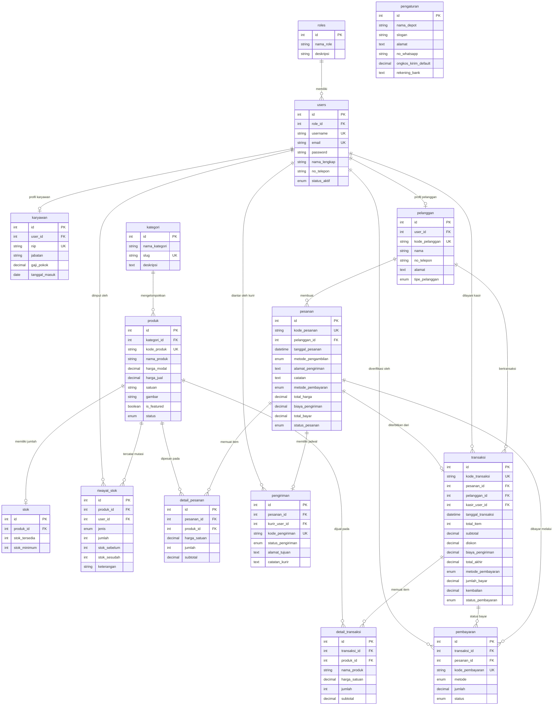

# AquaDepot - Sistem Informasi Manajemen Depot Air Mineral

> **AquaDepot** adalah aplikasi web modern berbasis **PHP Native (PDO) & MySQL** yang dirancang khusus untuk manajemen operasional depot air mineral sekaligus memberikan kemudahan pemesanan air galon secara online kepada pelanggan.

---

## 🌟 Fitur Utama Sistem

### 1. Hak Akses Tiga Role Pengguna (RBAC)
- **👑 Admin (Pemilik/Manajer Depot)**:
  - Dashboard eksekutif dengan statistik real-time (omset hari ini, total transaksi, pesanan masuk, total pelanggan, total produk, peringatan stok menipis).
  - Grafik tren penjualan 7 hari terakhir, grafik bulanan, dan produk paling laris (Chart.js).
  - CRUD Produk lengkap dengan kategori, harga modal, harga jual, dan upload foto.
  - CRUD Kategori produk.
  - Manajemen stok: pencatatan pasokan masuk (restock), stok keluar, stok minimum, dan mutasi riwayat stok.
  - Manajemen pesanan online pelanggan & update status otomatis.
  - Manajemen transaksi penjualan, filter tanggal, cetak invoice, dan pembatalan transaksi dengan pengembalian stok otomatis.
  - Manajemen armada & pengiriman kurir (6 alur status standar).
  - Manajemen data pelanggan & riwayat belanja.
  - Manajemen akun karyawan (NIP, jabatan, gaji pokok, aktivasi/penonaktifan akun).
  - Laporan & analisis lengkap: harian, mingguan, bulanan, tahunan, produk terlaris, audit nilai aset stok barang, margin keuntungan (laba bersih), serta Export ke **Excel/CSV** dan cetak **PDF**.
  - Pengaturan profil depot: kontak WhatsApp, tarif ongkir default, daftar rekening bank, jam operasional, dan embed peta Google Maps.

- **👷 Karyawan (Operator Kasir & Kurir Lapangan)**:
  - Dashboard operasional harian (pesanan baru masuk, diproses, selesai, kasir masuk).
  - **Kasir POS (Point of Sale)**: Input transaksi langsung walk-in pelanggan, pilih produk cepat, kalkulasi subtotal, diskon, ongkir, input nominal bayar, kalkulasi kembalian otomatis, dan cetak struk kasir thermal (80mm).
  - Kelola & proses pesanan pelanggan online.
  - Kelola pengiriman armada kurir (status siap kirim, OTW kirim, selesai, catatan kurir).
  - Perbarui ketersediaan stok & input pasokan galon masuk.
  - Kelola data pelanggan dan nomor WhatsApp.
  - *Pembatasan Ketat*: Karyawan tidak dapat mengakses manajemen akun pengguna dan konfigurasi utama sistem.

- **👤 Pelanggan (Masyarakat & Pelanggan Langganan)**:
  - Registrasi akun baru & login aman.
  - Katalog produk air galon isi ulang RO, galon bermerek, kemasan botol/gelas, dan aksesoris.
  - Keranjang belanja interaktif (tambah, kurangi, hapus item, hitung otomatis).
  - Checkout fleksibel: pilihan layanan antar kurir vs ambil mandiri di depot.
  - Pilihan metode pembayaran: COD (Bayar di tempat), Tunai di kasir, Transfer Bank (tampil nomor rekening resmi), dan QRIS.
  - Konfirmasi pemesanan langsung terintegrasi tombol otomatis ke WhatsApp depot.
  - Dashboard pelanggan: lacak status pengantaran galon dan riwayat pemesanan.
  - Cetak struk/invoice pesanan.
  - Manajemen profil dan ubah password.

### 2. Konsep Desain UI/UX
- **Modern Dashboard & Glassmorphism**: Tampilan modern dengan efek frosted glass (`backdrop-filter: blur`), border halus, dan bayangan neumorphic lembut.
- **Dark Mode & Light Mode**: Tombol toggle tema dengan penyimpanan status pada `localStorage` browser.
- **Palet Warna Resmi**:
  - Primary: `#1976D2` (Biru Utama)
  - Secondary: `#64B5F6` (Biru Muda)
  - Background: `#F4F8FC`
  - Success: `#2EAD68` (Hijau)
  - Danger: `#E53935` (Merah)
- **Animasi & Interaktivitas**:
  - Animasi transisi halus saat scrolling menggunakan **AOS (Animate On Scroll)**.
  - Dialog konfirmasi hapus data dan notifikasi toast menggunakan **SweetAlert2**.
  - Floating label pada seluruh form input.
  - Sidebar responsif untuk perangkat mobile dan desktop.

---

## 🗄️ Struktur Basis Data (ERD)

Database: **`aquadepot_db`**

### Diagram Relasi Entitas (Mermaid ERD):



---

## 📁 Struktur Direktori Proyek

```
Depot air/
│
├── config/
│   ├── config.php            # Helper URL dinamis, helper format rupiah, CSRF token, session, auth middleware
│   └── database.php          # Koneksi database PDO Singleton dengan penanganan error ramah
│
├── database/
│   └── aquadepot_db.sql      # Struktur lengkap 15 tabel MySQL dan dataset awal siap uji
│
├── includes/
│   ├── header.php            # Navbar publik, toggle tema, indikator keranjang belanja
│   ├── footer.php            # Footer informasi depot, floating WhatsApp widget, pemanggilan library JS
│   ├── topbar.php            # Topbar modern dashboard Admin & Karyawan
│   ├── sidebar_admin.php     # Sidebar kaca modern Admin lengkap dengan badge pesanan & stok menipis
│   └── sidebar_karyawan.php  # Sidebar operasional staf depot
│
├── auth/
│   ├── login.php             # Form login modern dengan tombol cepat akun uji coba
│   ├── register.php          # Pendaftaran mandiri pelanggan online
│   └── logout.php            # Pembersihan sesi dan logout aman
│
├── models/
│   ├── User.php              # Model akses data pengguna & karyawan
│   ├── Product.php           # Model produk & filter kategori
│   ├── Order.php             # Model pesanan & detail pesanan
│   ├── Transaction.php       # Model transaksi kasir & kalkulasi omset
│   └── Stock.php             # Model stok, mutasi, dan pengiriman
│
├── controllers/
│   └── CartController.php    # Pengelolaan keranjang session & endpoint AJAX
│
├── admin/
│   ├── index.php             # Dashboard Admin: 6 KPI Cards, Chart.js penjualan, pesanan terbaru
│   ├── produk.php            # CRUD produk, upload gambar, harga modal & jual, stok awal
│   ├── kategori.php          # CRUD kategori produk
│   ├── stok.php              # Manajemen stok masuk, mutasi log, peringatan stok menipis
│   ├── transaksi.php         # Riwayat seluruh transaksi kasir, filter tanggal, batalkan transaksi
│   ├── pesanan.php           # Kelola pesanan online, update status pesanan, rollback stok otomatis
│   ├── pengiriman.php        # Kelola 6 status pengiriman & penugasan kurir depot
│   ├── pelanggan.php         # CRUD data pelanggan & riwayat transaksi
│   ├── karyawan.php          # CRUD data karyawan, akun user, gaji, aktivasi akun
│   ├── laporan.php           # Laporan omset, laba bersih, terlaris, audit stok, Export CSV & Print PDF
│   └── pengaturan.php        # Konfigurasi profil depot, WhatsApp, ongkir, rekening bank, embed peta
│
├── karyawan/
│   ├── index.php             # Dashboard operasional karyawan
│   ├── kasir.php             # Kasir POS transaksi langsung walk-in depot (hitung kembalian otomatis)
│   ├── pesanan.php           # Daftar & update status proses pesanan pelanggan
│   ├── pengiriman.php        # Pengantaran kurir & catatan serah terima barang
│   ├── stok.php              # Pantau stok produk & input restock pasokan air masuk
│   ├── pelanggan.php         # Pencarian pelanggan & input pelanggan baru
│   └── cetak_struk.php       # Layout struk thermal 80mm printer kasir
│
├── pelanggan/
│   ├── index.php             # Dashboard akun pelanggan (status pesanan aktif, total belanja)
│   ├── riwayat.php           # Riwayat pesanan, modal detail item, lacak pengiriman kurir
│   └── profil.php            # Ubah data diri, alamat pengiriman, dan ganti password
│
├── views/
│   ├── produk.php            # Katalog publik produk air galon & kemasan dengan filter kategori & pencarian
│   ├── keranjang.php         # Keranjang pemesanan (ubah jumlah, subtotal, hapus item)
│   ├── checkout.php          # Checkout pemesanan: nama, WA, alamat, opsi antar/ambil sendiri, metode bayar
│   ├── pesanan_sukses.php    # Konfirmasi pesanan sukses dengan tombol kirim WhatsApp otomatis
│   └── cetak_invoice.php     # Format cetak invoice faktur resmi A4 / cetak printer
│
├── assets/
│   ├── css/
│   │   └── style.css         # Styling Glassmorphism, Neumorphism, Microinteractions, Dark Mode
│   ├── js/
│   │   ├── main.js           # Pengatur tema, sidebar mobile, notifikasi SweetAlert2
│   │   └── cart.js           # AJAX penambahan produk ke keranjang & update badge navbar
│   └── images/
│       ├── default_product.svg  # Ilustrasi vektor galon air higienis
│       └── logo.png
│
├── index.php                 # Halaman Beranda Publik (Hero, produk unggulan, 4 cara pesan, testimoni, Maps)
└── README.md                 # Dokumentasi proyek lengkap
```

---

## 🔑 Akun Login Pengujian

Sistem telah dilengkapi dengan data akun awal untuk memudahkan pengujian seluruh role:

| Role | Username | Password | Email | Keterangan |
| :--- | :--- | :--- | :--- | :--- |
| **👑 ADMIN** | `admin` | `admin123` | `admin@aquadepot.id` | Hak akses penuh seluruh modul sistem |
| **👷 KARYAWAN** | `karyawan` | `karyawan123` | `karyawan@aquadepot.id` | Operator kasir & pemrosesan pesanan |
| **🚚 KURIR** | `kurir_agus` | `karyawan123` | `agus@aquadepot.id` | Staf operasional pengantaran armada |
| **👤 PELANGGAN** | `pelanggan` | `pelanggan123` | `pelanggan@gmail.com` | Pelanggan terdaftar |
| **🏢 PELANGGAN BISNIS** | `ahmad_fauzi` | `pelanggan123` | `ahmadfauzi@gmail.com` | Pelanggan segmen kantor/usaha |

> 💡 *Tips:* Pada halaman login (`auth/login.php`), tersedia **tombol pintas (quick button)** untuk otomatis mengisi username dan password masing-masing role hanya dengan satu klik!

---

## 🚀 Panduan Instalasi Menggunakan XAMPP

### Langkah 1: Persiapan Folder di XAMPP
1. Pastikan aplikasi **XAMPP** sudah terinstal di komputer Anda.
2. Salin folder proyek ini (atau beri nama folder `aquadepot`) ke dalam direktori `htdocs` XAMPP Anda:
   ```
   C:\xampp\htdocs\aquadepot
   ```

### Langkah 2: Menyalakan Layanan Apache & MySQL
1. Buka **XAMPP Control Panel**.
2. Klik tombol **Start** pada modul **Apache**.
3. Klik tombol **Start** pada modul **MySQL**.
4. Pastikan kedua indikator berwarna hijau.

### Langkah 3: Import Database MySQL
1. Buka browser Anda (Google Chrome / Microsoft Edge / Firefox), lalu buka alamat:
   ```
   http://localhost/phpmyadmin
   ```
2. Klik menu **Databases** (atau **Basis Data**) pada bagian atas.
3. Pada kolom *Create database*, ketik nama basis data:
   ```
   aquadepot_db
   ```
   Lalu klik tombol **Create**.
4. Klik database `aquadepot_db` yang baru dibuat di panel sebelah kiri.
5. Pilih tab menu **Import** di bagian atas.
6. Klik tombol **Choose File** (Pilih Berkas) dan arahkan ke file SQL yang berada di dalam folder proyek:
   ```
   htdocs/aquadepot/database/aquadepot_db.sql
   ```
7. Gulir ke bawah lalu klik tombol **Import** (atau **Kirim**).
8. Tunggu beberapa detik hingga muncul pesan sukses berwarna hijau: *"Import has been successfully finished"*.

---

## 💻 Panduan Menjalankan Website melalui Localhost

### Opsi A: Melalui Apache XAMPP
Buka peramban (browser) Anda, lalu kunjungi alamat URL berikut:
```
http://localhost/aquadepot/
```
*(Atau sesuaikan dengan nama folder proyek Anda di `htdocs`, misal: `http://localhost/Depot%20air/`)*

### Opsi B: Menggunakan PHP Built-in Server
Jika Anda menggunakan Visual Studio Code dan ingin menjalankan server tanpa Apache:
1. Buka terminal di folder proyek (`Depot air`).
2. Jalankan perintah:
   ```bash
   php -S localhost:8000
   ```
3. Buka browser dan akses:
   ```
   http://localhost:8000
   ```

---

## 🧪 Panduan Pengujian Fitur (Testing Scenario)

### Skenario 1: Halaman Publik & Pemesanan Pelanggan (Online Order)
1. Buka `http://localhost/aquadepot/`.
2. Jelajahi bagian **Hero**, **Keunggulan**, **Cara Pesan**, **Testimoni**, dan **Google Maps**.
3. Klik menu **Katalog Produk**, coba gunakan fitur pencarian produk atau filter berdasarkan kategori.
4. Klik tombol **Pesan** pada produk *Air Galon Isi Ulang RO (Reverse Osmosis)*. Notifikasi pop-up SweetAlert2 akan muncul dan badge angka di ikon keranjang pada navbar otomatis bertambah.
5. Klik ikon **Keranjang Belanja**. Coba ubah jumlah pesanan menggunakan tombol `+` atau `-`.
6. Klik tombol **Lanjut ke Checkout**.
7. Isi nama lengkap, nomor WhatsApp, pilih opsi **Layanan Antar Kurir**, masukkan alamat pengantaran, dan pilih metode pembayaran (misal **COD** atau **Transfer Bank**).
8. Klik **Konfirmasi & Buat Pesanan**.
9. Anda akan diarahkan ke halaman **Pesanan Berhasil** dengan kode pesanan unik.
10. Klik tombol **Konfirmasi via WhatsApp Depot** untuk melihat integrasi pesan otomatis yang telah diformat rapi.

### Skenario 2: Login Akun Pelanggan & Tracking Pesanan
1. Klik tombol **Masuk** pada navbar.
2. Gunakan tombol cepat akun `Pelanggan` (atau isi `pelanggan` / `pelanggan123`).
3. Masuk ke **Dashboard Saya** (`pelanggan/index.php`). Periksa statistik total pesanan dan total belanja.
4. Masuk ke tab **Riwayat Pesanan** (`pelanggan/riwayat.php`). Klik tombol **Detail** pada modal untuk melihat rincian barang, kurir pengantar, dan klik **Cetak Struk**.
5. Buka tab **Profil Saya** (`pelanggan/profil.php`), coba perbarui nomor WhatsApp atau alamat pengiriman Anda.

### Skenario 3: Operasional Karyawan & Kasir POS
1. Logout dari akun pelanggan, lalu buka halaman login.
2. Klik tombol cepat `Karyawan` (atau masukkan `karyawan` / `karyawan123`).
3. Anda akan otomatis diarahkan ke **Dashboard Karyawan** (`karyawan/index.php`).
4. Klik menu **Kasir POS (Input Transaksi)** (`karyawan/kasir.php`).
5. Klik beberapa produk air galon di panel katalog, lihat bagaimana item langsung masuk ke daftar tagihan di panel kanan.
6. Masukkan nominal uang yang dibayarkan pelanggan pada input *Uang Diterima*, sistem otomatis menghitung kembalian secara real-time.
7. Klik **Simpan & Cetak Struk**. Transaksi kasir tersimpan ke database, stok produk terpotong secara otomatis, dan struk kasir thermal 80mm langsung terbuka siap dicetak!
8. Masuk ke menu **Daftar Pesanan** (`karyawan/pesanan.php`), temukan pesanan online yang dibuat pada Skenario 1, lalu klik **Ubah Status** menjadi *Pesanan Diproses* atau *Siap Dikirim*.
9. Buka menu **Kelola Pengiriman** (`karyawan/pengiriman.php`), isi catatan kurir dan perbarui status menjadi *Pesanan Selesai*.
10. Coba akses menu terlarang (seperti `admin/karyawan.php`), sistem akan otomatis menolak akses dan mengembalikan karyawan ke panelnya (RBAC Security).

### Skenario 4: Panel Administrator Penuh
1. Logout dari karyawan, lalu login menggunakan akun `Admin` (`admin` / `admin123`).
2. Periksa **Dashboard Admin** (`admin/index.php`):
   - Perhatikan 6 kartu KPI statistik yang terisi angka akurat dari database.
   - Periksa 3 grafik interaktif **Chart.js**: Tren Penjualan 7 Hari Terakhir, Peringkat Produk Terlaris (Doughnut), dan Penjualan Bulanan (Bar).
   - Periksa tabel transaksi dan pesanan terbaru.
3. Buka menu **Produk** (`admin/produk.php`):
   - Coba klik tombol **Tambah Produk Baru**, isi formulir, tentukan harga modal dan harga jual, lalu simpan.
   - Coba tombol **Edit** dan **Hapus** dengan dialog konfirmasi SweetAlert2.
4. Buka menu **Manajemen Stok** (`admin/stok.php`):
   - Lihat status level stok (Aman / Menipis).
   - Klik tombol **Restock**, tambahkan pasokan galon (misal +50 unit). Periksa tabel **Riwayat Mutasi Stok** di bagian bawah, perubahan stok tercatat rapi secara kronologis.
5. Buka menu **Laporan & Rekap** (`admin/laporan.php`):
   - Ganti filter periode menjadi *Hari Ini*, *Minggu Ini*, atau *Bulan Ini*.
   - Periksa kalkulasi otomatis **Total Omset**, **Total Modal (HPP)**, dan **Laba Bersih Keuntungan**.
   - Klik tombol **Export ke Excel / CSV** untuk mengunduh berkas laporan dalam format `.csv` yang dapat dibuka langsung di Microsoft Excel.
   - Klik tombol **Cetak Laporan (PDF)** untuk mencetak atau menyimpan dokumen PDF rapi.
6. Buka menu **Pengaturan Depot** (`admin/pengaturan.php`):
   - Ubah nomor WhatsApp depot atau tarif ongkir default, lalu klik simpan. Periksa footer website publik untuk melihat perubahan yang langsung diterapkan.
7. Coba tombol **Ganti Tema (Dark / Light Mode)** pada topbar navigasi. Seluruh halaman akan bertransisi mulus ke mode gelap/terang dan preferensi Anda tersimpan di browser.

---

## 🔒 Standar Keamanan Sistem (Security Implementations)

1. **Password Hashing Modern**: Menggunakan fungsi standar industri `password_hash()` dengan algoritma Bcrypt dan verifikasi autentikasi menggunakan `password_verify()`.
2. **Prepared Statements (PDO)**: Seluruh interaksi database menggunakan parameter binding untuk mencegah serangan **SQL Injection**.
3. **Cross-Site Request Forgery (CSRF) Protection**: Setiap request pengiriman formulir POST dilengkapi dengan validasi token keamanan acak `csrf_token()`.
4. **Cross-Site Scripting (XSS) Prevention**: Seluruh output dinamis disanitasi menggunakan `htmlspecialchars(..., ENT_QUOTES, 'UTF-8')`.
5. **Role-Based Access Control (RBAC)**: Setiap endpoint file PHP memanggil middleware `require_role([...])` untuk memverifikasi hak akses pengguna sebelum merender halaman.
6. **Database Transactions**: Transaksi kasir, pembuatan pesanan, dan pembatalan pesanan dikemas di dalam `beginTransaction()`, `commit()`, dan `rollBack()` untuk menjamin konsistensi data stok dan keuangan (*ACID compliant*).
7. **Session Hardening & Destruction**: Fitur logout menghapus cookie sesi dan menjalankan pembersihan sesi secara komprehensif.

---

## 👨‍💻 Pengembang
- **Nama Aplikasi**: AquaDepot - Sistem Informasi Manajemen Depot Air Mineral
- **Mata Kuliah**: Tugas Internet Programming (Pemrograman Internet) Semester 3
- **Tahun**: 2026

